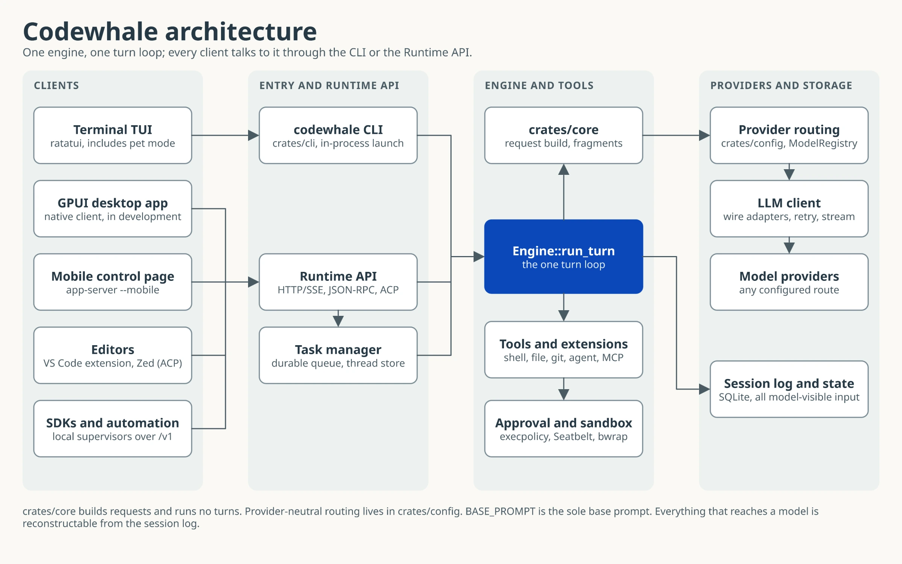

# Codewhale Architecture

> 阅读简体中文版：[zh_hans/ARCHITECTURE.md](zh_hans/ARCHITECTURE.md)。

Codewhale Engine is the existing Rust execution runtime. The
[Runtime API](RUNTIME_API.md) is its client interface, and
[TypeScript mods](EXTENSIONS.md) contribute reviewed extensions.

Current boundary note (read the workspace version from `Cargo.toml`; this
boundary has held since v0.9.1):
- `crates/tui` is still the live end-user runtime for the TUI, runtime API, task manager, and tool execution loop.
- Other workspace crates are being split out incrementally, but they are not yet the sole runtime source of truth.



The diagram draws the Runtime API and the task manager as their own boxes; today
both are hosted inside `crates/tui`, as the note above says. The GPUI desktop
app and the VS Code extension live outside this repository. The arrow from the
engine to the session log follows the "model-visible means logged" contract
rather than a traced write path.
- `crates/tui` is being split into crates sized as agent work partitions:
  contracts, utilities, services, providers, runtime, leaf feature crates,
  TUI views and hosts, in the order `docs/design/TUI_DECONSTRUCTION.md`
  records. The TUI stays the only crate that writes to the terminal. Until a
  module has moved, its path under `crates/tui/src` is still where it lives.
- The LSP subsystem (`crates/tui/src/lsp/`) is fully wired into the engine's
  post-tool-execution path (`core/engine/lsp_hooks.rs`), providing inline
  diagnostics after `File` write, edit, and patch actions.
- The swarm agent system was removed in v0.8.5. The active sub-agent surface is
  the single `agent` tool; persistent RLM sessions are available through the
  deferred `rlm` action family.
  No model-visible swarm tool remains in the active codebase.

## High-Level Overview

```
┌─────────────────────────────────────────────────────────────────┐
│                         User Interface                          │
│  ┌─────────────────┐  ┌─────────────────┐  ┌────────────────┐  │
│  │   TUI (ratatui) │  │  One-shot Mode  │  │  Config/CLI    │  │
│  └────────┬────────┘  └────────┬────────┘  └────────┬───────┘  │
└───────────┼─────────────────────┼────────────────────┼──────────┘
            │                     │                    │
            ▼                     ▼                    ▼
┌─────────────────────────────────────────────────────────────────┐
│                        Core Engine                              │
│  ┌─────────────────────────────────────────────────────────┐   │
│  │                    Agent Loop (core/engine.rs)           │   │
│  │  ┌─────────┐  ┌─────────────┐  ┌──────────────────────┐ │   │
│  │  │ Session │  │ Turn Mgmt   │  │ Tool Orchestration   │ │   │
│  │  └─────────┘  └─────────────┘  └──────────────────────┘ │   │
│  └─────────────────────────────────────────────────────────┘   │
└─────────────────────────────────────────────────────────────────┘
            │                     │                    │
            ▼                     ▼                    ▼
┌─────────────────────────────────────────────────────────────────┐
│                     Tool & Extension Layer                      │
│  ┌──────────┐  ┌──────────┐  ┌─────────┐  ┌────────────────┐   │
│  │  Tools   │  │  Skills  │  │  Hooks  │  │  MCP Servers   │   │
│  │ (shell,  │  │ (plugins)│  │ (pre/   │  │  (external)    │   │
│  │  file)   │  │          │  │  post)  │  │                │   │
│  └──────────┘  └──────────┘  └─────────┘  └────────────────┘   │
└─────────────────────────────────────────────────────────────────┘
            │                     │                    │
            ▼                     ▼                    ▼
┌─────────────────────────────────────────────────────────────────┐
│                  Runtime API + Task Management                  │
│  ┌─────────────────────────────┐  ┌──────────────────────────┐  │
│  │ HTTP/SSE Runtime API        │  │ Persistent Task Manager  │  │
│  │ (runtime_api.rs)            │  │ (task_manager.rs)        │  │
│  └─────────────────────────────┘  └──────────────────────────┘  │
└─────────────────────────────────────────────────────────────────┘
            │                     │
            ▼                     ▼
┌─────────────────────────────────────────────────────────────────┐
│                        LLM Layer                                │
│  ┌──────────────────────────────────────────────────────────┐  │
│  │               LLM Client Layer (client.rs)               │  │
│  │  ┌──────────────────┐  ┌─────────────────────────────┐   │  │
│  │  │ OpenAI-compatible │  │  Anthropic / Responses      │   │  │
│  │  │  (chat adapter)  │  │   (adapters)                │   │  │
│  │  └──────────────────┘  └─────────────────────────────┘   │  │
│  └──────────────────────────────────────────────────────────┘  │
└─────────────────────────────────────────────────────────────────┘
```

## Module Organization

### Entry Point

- **`crates/cli/src/main.rs`** - The canonical executable entry point. `crates/cli/src/lib.rs` owns its command interface; terminal and headless runtime startup runs in process through the `codewhale_tui` library in `crates/tui/src/lib.rs`.

### Core Components

- **`core/`** - Main engine components
  - `engine.rs` - Engine state, operation handling, message processing
  - `engine/turn_loop.rs` - The existing Engine outer turn loop, shared tool
    planner/executor/result handling, and stream decoder. Its private
    `turn_loop/` phases contain request preparation (`preparation.rs`), model
    dispatch and admission (`model_step.rs`), the ordered continuation ladder
    (`continuation.rs`), inline REPL orchestration (`inline_repl.rs`), and the
    direct model tool batch (`tool_batch.rs`). They borrow the same Engine and
    TurnContext; they introduce no runtime, session, prompt, approval, event,
    or persistence authority. Retry, loop termination, and immediate return
    stay distinct, and only the existing productive paths advance the step.
  - `session.rs` - Session state management
  - `turn.rs` - Turn-based conversation handling
  - `events.rs` - Event system for UI updates
  - `ops.rs` - Core operations

### Configuration

- **`config.rs`** - Configuration loading, profiles, environment variables
- **`settings.rs`** - Runtime settings management

### Workspace Crates

- **`crates/cli`** - The canonical `codewhale` executable and command interface.
  It owns commands such as `auth`, `metrics` and `update`, and invokes terminal
  and headless modes (`run`, `exec`, `doctor`, `sessions`, ...) in process via
  `codewhale_tui::run(RuntimeOptions, args)`. `crates/tui` is a library; the
  `codew` and legacy release filename aliases contain the same executable.
- **`crates/tools`** - Shared tool invocation primitives, including tool result/error/capability types used by the TUI runtime.
- **`crates/agent`** - Model/provider registry (ModelRegistry) for resolving model IDs to provider endpoints.
- **`crates/app-server`** - HTTP/SSE + JSON-RPC app server transport for
  headless agent workflows. The canonical executable dispatches
  `app-server --http`/`--mobile` in process to the runtime API hosted by the
  `codewhale_tui` library.
- **`crates/config`** - Config loading, profiles, environment variable precedence, CLI runtime overrides.
- **`crates/cloud-facts`** - Fetches the signed Codewhale cloud facts channel
  (`facts/v1`), verifies its Ed25519 envelope, and keeps a verified disk cache;
  never a startup dependency.
- **`crates/command-contract`** - Prototype command capability and dispatch
  shapes for the staged extraction of TUI commands; shapes only, not yet the
  production dispatch path.
- **`crates/core`** - Provider-neutral request construction (`request.rs`),
  bounded context fragments, the tool-call parser, and thread/session types.
  It does **not** own the agent loop: the live turn loop is
  `Engine::run_turn` in `crates/tui/src/core/engine/turn_loop.rs`, and
  `crates/tui/src/core/` is a module inside the TUI crate, not this crate. A
  placeholder `engine/` tree here once suggested otherwise — it had no callers
  and emitted `TurnComplete` without contacting a model — and was removed in
  v0.9.11. The source guard follows resolved local phase calls and still
  rejects unlisted loop owners. ACP stdio now projects the existing Runtime
  manager and Engine; it keeps no provider/tool round loop or separate history.
  Recursive RLM and mounted Python RPCs now project captured caller authority
  onto the same Engine producer and Session; no RLM loop exception remains.
  Python retains its context and variables, while each round borrows the
  captured route, Native selection, original code gate, cancellation and
  deadline. Task guidance is bounded and additive to Core policy. Recursive
  history is retained whole; overflow refuses rather than compacting it.
  Persistent `rlm` contexts remain caller-session scoped and `share_session=true`
  explicitly refuses. Child workers also use their captured admission in the
  same Engine; neither nested host retains a turn-loop exception.
- **`crates/execpolicy`** - Approval/sandbox policy engine for tool execution decisions.
- **`crates/hooks`** - Event sinks (stdout, JSONL file, webhook, Unix socket)
  for response, tool, job and approval lifecycle events, plus the opt-in
  lifecycle outbox. User-configured shell hooks that run commands around tool
  calls are a separate system in `crates/tui/src/hooks.rs`.
- **`crates/localization`** - Locale registry for user-facing UI chrome strings
  (`crates/localization/locales/*.json`); it never changes prompts or model
  output language.
- **`crates/mcp`** - MCP client + stdio server for Model Context Protocol tool servers.
- **`crates/memory`** - Local, scoped, provenance-bearing memory and
  resumable state (a library, not a second agent loop).
- **`crates/models`** - Provider request/response models and the offline model
  metadata catalog.
- **`crates/palette`** - Colour tokens, themes, and contrast math for the
  terminal UI. Its `ratatui` feature (on by default) gates everything that
  renders; theme ids, setting normalizers and hex parsing compile without it,
  which is how the runtime links it.
- **`crates/paths`** - User-scoped runtime path authority (`CODEWHALE_HOME`
  and platform home resolution).
- **`crates/protocol`** - Request/response framing and protocol types.
- **`crates/runtime`** - `codewhale-runtime`, the headless runtime being
  split out of `crates/tui` (`docs/design/TUI_DECONSTRUCTION.md`). Today it
  holds the leaf modules that moved first (retry status, safe labels, sleep
  guard, session tree, ...) and `host_terminal`, the one port through which
  runtime code asks the terminal UI for a terminal effect. It never depends on
  the TUI, `ratatui` or `crossterm`; `scripts/check-command-crate-boundaries.py`
  enforces that and ratchets the runtime -> UI references still in `crates/tui`.
- **`crates/secrets`** - OS keyring integration for API key storage, plus the
  shared output sanitizer (`sanitize`) and redaction (`redact`) that UI and
  runtime code both call.
- **`crates/state`** - SQLite thread/session persistence layer.
- **`crates/telemetry`** - Anonymous, user-disableable aggregate usage
  counting; the only crate allowed to build or send a telemetry payload
  (`docs/TELEMETRY.md`).
- **`crates/workflow`** / **`crates/workflow-js`** - Workflow engine and its
  QuickJS scripting layer (renamed from the whaleflow crates).
- **`crates/lane`** - Lane runtime: durable, attachable running instances of
  Fleet/Workflow work (`codewhale lane list/status/attach/logs/stop`).
- **`crates/release`** / **`crates/build-support`** - Release checks and build
  plumbing.

### LLM Integration

- **`client.rs`** - The live HTTP client layer: OpenAI-compatible, Anthropic,
  and Responses wire adapters, DeepSeek request-boundary handling, retry
  policy, and streaming. Provider routes land here through the shared config
  and catalog layers.
- **`llm_client/`** - LLM client trait, retry logic, and error classification
  (`LlmClient`, `RetryConfig`, `with_retry`) consumed by `client.rs`; `mock.rs`
  is test-only (`#[cfg(test)]`).
- **`crates/models`** (`codewhale_models`) - Data structures for API
  requests/responses; the TUI crate has no local `models.rs`.

#### DeepSeek API Endpoints

DeepSeek exposes OpenAI-compatible endpoints. The first-party route uses:
- `https://api.deepseek.com/beta` - default DeepSeek base URL (`provider_defaults.rs`)
- `https://api.deepseek.com/beta/models` - live model discovery and health checks

`https://api.deepseek.com/v1` is accepted for OpenAI SDK compatibility, and
can still be configured explicitly to opt out of beta-only features such as
strict tool mode, chat prefix completion, and FIM completion. The public
DeepSeek docs do not document a Responses API path for this workflow; the engine
drives turns through Chat Completions.

### Tool System

- **`tools/`** - Built-in tool implementations
  - `mod.rs` - Tool registry and common types
  - `shell.rs` - Shell command execution
  - `file.rs` - File read/write operations
  - `todo.rs` - Checklist tools plus legacy todo aliases
  - `tasks.rs` - Model-visible durable task, gate, background shell, and PR-attempt tools
  - `git.rs` - Read-only `git_status` / `git_diff` inspection wrappers
  - `git_tool.rs` - The canonical action-based `Git` tool (`status | diff | log | show | blame`); per-action legacy aliases were removed in v0.9.3
  - `git_history.rs` - Read-only `git_log` / `git_show` / `git_blame`
  - `github/` - Unified `github` tool family (read-only context plus guarded
    comment/closure actions backed by `gh`); deferred by default and
    discoverable through `tool_search`
  - `automation.rs` - Model-visible scheduling tools over `AutomationManager`
  - `plan.rs` - Planning tools
  - `subagent/` - Sub-agent launch and supervision. `agent` is the one
    creation surface; `subagent/coord.rs` adds narrow coordination tools
    (`agents/list`, `agents/message`, `agents/followup`, `agents/interrupt`,
    `agents/wait`, `agents/coordinate`) over the existing manager. The
    `agent_open`/`agent_eval`/`agent_close` lifecycle surface was retired
    (see the `subagent/coord.rs` module doc)
  - `spec.rs` - Tool specifications
  - `rlm.rs` - Persistent Recursive Language Model (RLM) sessions — persistent local Python REPL subprocesses (environment-scrubbed, not OS-sandboxed) with semantic helper calls and `var_handle` output support

### Extension Systems

- **`mcp.rs`** - Model Context Protocol client for external tool servers
- **`skills/`** - Skill discovery and registry for local `SKILL.md` files, plus install and audit
- **`hooks.rs`** - Pre/post execution hooks with conditions

### User Interface

- **`tui/`** - Terminal UI components (ratatui-based; this is a representative
  list, not exhaustive - the module has grown to 80+ focused files):
  - `app.rs` - Application state and message handling
  - `ui.rs` - Event handling, streaming state, and rendering logic
  - `approval.rs` - Tool approval dialog
  - `clipboard.rs` - Clipboard handling
  - `underwater.rs` - Main shell chrome: status chips, mode labels, phase rail

### LSP Integration

- **`lsp/`** - Post-edit diagnostics injection (#136)
  - `mod.rs` - `LspManager` — lazy per-language transport pool + config
  - `client.rs` - `StdioLspTransport` — JSON-RPC over stdio with `didOpen`/`didChange`/`publishDiagnostics`
  - `diagnostics.rs` - Diagnostic types, severity, and HTML-block renderer
  - `registry.rs` - Language detection and the default server map: `rust-analyzer`,
    `gopls`, `pyright-langserver`, `typescript-language-server`, `jdtls`,
    `intelephense` (PHP), `vue-language-server`, `clangd` (`lsp/registry.rs:98-110`)
  - Wired into the engine via `core/engine/lsp_hooks.rs` — called after every successful edit

### Security

- **`sandbox/`** - platform sandbox policy preparation and denial reporting
  - `mod.rs` - Sandbox type definitions
  - `backend.rs` - Pluggable sandbox backend abstraction (routes shell
    execution to a remote service, e.g. Alibaba OpenSandbox)
  - `policy.rs` - Sandbox policy configuration
  - `opensandbox.rs` - Alibaba OpenSandbox HTTP backend adapter
  - `seatbelt.rs` - macOS Seatbelt profile generation
  - `bwrap.rs` - Linux bubblewrap command wrapper
  - `seccomp.rs` - dormant Linux seccomp implementation; not wired into commands
  - `process_hardening.rs` - Linux kernel-level hardening for the TUI process
    itself (defense-in-depth; not a child-command sandbox)
  - `windows.rs` - Windows helper contract; not advertised until a Job
    Object process-containment helper exists

### Utilities

- **`utils.rs`** - Common utilities
- **`logging.rs`** - Logging infrastructure
- **`compaction.rs`** - Context compaction for long conversations
- **`purge.rs`** - Agent-driven context purging (surgical message removal/rewriting)
- **`pricing.rs`** - Cost estimation
- **`prompts.rs`** - System prompt templates
- **`runtime_api.rs`** - HTTP/SSE runtime API (`codewhale serve --http`)
- **`runtime_threads.rs`** - Durable thread/turn/item store + replayable event timeline
- **`task_manager.rs`** - Durable queue, worker pool, task timelines and artifacts

## Data Flow

### Interactive Session

1. User input received in TUI
2. Input processed by `core/engine.rs`
3. Message sent to LLM via `client.rs`
4. Response streamed back, parsed in `client.rs`
5. Tool calls extracted and executed via `tools/`
6. Hooks triggered before/after tool execution
7. Results aggregated and sent back to LLM
8. Final response rendered in TUI

### Crash Recovery + Offline Queue

1. Before sending user input, the TUI writes a checkpoint snapshot to `~/.codewhale/sessions/checkpoints/latest.json`
2. Startup remains fresh by default; prior sessions are resumed explicitly via `--resume`/`--continue` (or `Ctrl+R` in TUI)
3. While degraded/offline, new prompts are queued in-memory and mirrored to `~/.codewhale/sessions/checkpoints/offline_queue.json`
4. Queue edits (`/queue ...`) are persisted continuously so drafts and queued prompts survive restarts
5. Successful turn completion clears the active checkpoint and writes a durable session snapshot
6. Action-capable turns also take pre/post-turn side-git workspace snapshots under `~/.codewhale/snapshots/<project_hash>/<worktree_hash>/.git`; `/restore N` and `revert_turn` restore file state without changing conversation history or the user's `.git`

### Tool Execution

1. LLM requests tool via `tool_use` content block
2. Tool registry looks up handler
3. Pre-execution hooks run
4. Approval requested when the effective permission posture and policy require it
5. Tool executed (possibly wrapped by Seatbelt on macOS or bubblewrap on Linux)
6. Post-execution hooks run
7. Result metadata is retained on runtime item records
8. **LSP post-edit hook**: after a `File` write, edit, or patch action (including a replay-only legacy alias), the engine runs `run_post_edit_lsp_hook()` when LSP is enabled to collect diagnostics
9. **Diagnostics flush**: before the next API request, `flush_pending_lsp_diagnostics()` injects any collected errors as a synthetic user message
10. Result returned to agent loop

### Background Tasks

1. Client enqueues task (`/task add ...` or `POST /v1/tasks`)
2. `task_manager.rs` persists task + queue entry under `~/.codewhale/tasks`
3. Worker picks queued task (bounded pool), transitions to `running`
4. Task creates/uses a runtime thread and starts a runtime turn
5. `runtime_threads.rs` persists thread/turn/item records + monotonic event sequence
6. Timeline/tool summaries/artifact references are persisted incrementally
7. Checklist state, verifier gates, PR attempts, and guarded GitHub events are applied from tool metadata to the active task
8. Final state (`completed|failed|canceled`) is durable and queryable via TUI/API

Model-visible durable task tools are a surface over this same manager. They do
not introduce a parallel work system: `task_create` enqueues normal tasks,
`checklist_*` updates task-local progress, `task_gate_run` and completed
`task_shell_wait` attach verification evidence, and automation runs enqueue
ordinary durable tasks.

### Runtime Thread/Turn Timeline

1. API/TUI creates or resumes a thread (`/v1/threads*`)
2. Turn starts on the thread (`/v1/threads/{id}/turns`)
3. Engine events are mapped to item lifecycle events (`item.started|item.delta|item.completed`)
4. Interrupt/steer operations apply to the active turn only
5. Compaction (auto/manual) is emitted as `context_compaction` item lifecycle
6. Purge (agent-driven) is emitted as `context_purge` item lifecycle
7. Clients replay history and resume with `/v1/threads/{id}/events?since_seq=<n>`

### Durable Schema Gates

- `session_manager.rs`, `runtime_threads.rs`, and `task_manager.rs` embed `schema_version` on persisted records.
- On load, newer schema versions are rejected with explicit errors instead of silently truncating/overwriting data.
- This allows safe forward migrations and prevents corruption when binaries and stored state are out of sync.

## Extension Points

### Adding a New Tool

1. Create handler in `tools/`
2. Register in `tools/registry.rs`
3. Add tool specification (name, description, input schema)

### Adding an MCP Server

1. Configure in `~/.codewhale/mcp.json`
2. Server auto-discovered at startup
3. Tools exposed to LLM automatically

### Creating a Skill

1. Create skill directory with `SKILL.md`
2. Define skill prompt and optional scripts
3. Place in a Codewhale-owned root (`~/.codewhale/skills/` or
   `<workspace>/.codewhale/skills/`), or import from a compatible harness root
   through `/skills`

See [SKILLS.md](SKILLS.md) for the Skills Manager, audit inventory, and the
rule that compatible roots (`.claude`, `.agents`, …) are never mutated in place.

### Adding Hooks

Configure in `~/.codewhale/config.toml`:

```toml
[[hooks]]
event = "tool_call_before"
command = "echo 'Running tool: $TOOL_NAME'"
```

## Key Design Decisions

1. **Streaming-first**: All LLM responses stream for responsiveness
2. **Tool safety**: Ask and Auto-Review require approval according to tool and
   managed policy; Full Access removes ordinary prompts but not hard safety
   holds. Side-effectful MCP tools use the same boundary.
3. **Extensibility**: MCP, skills, and hooks allow customization without code changes
4. **Cross-platform**: Core works on Linux/macOS/Windows. Sandbox guarantees
   are platform-specific: macOS uses Seatbelt when available; Linux uses an
   installed bubblewrap executable by default when a probe shows it works; Windows has
   no advertised OS command sandbox. Seccomp and the Windows helper contract
   are not wired into command execution.
5. **Minimal dependencies**: Careful dependency selection for build speed
6. **Local-first runtime API**: HTTP/SSE endpoints are intended for trusted localhost access and are served by the `crates/tui` runtime today
7. **Lock poison**: fail-stop by default. A poisoned lock means a holder
   panicked mid-mutation, so `.expect()` with a message naming the lock is
   the standard posture — never serve half-updated state. Recover with
   `into_inner()` only where stale state is safe (caches, idempotent
   rebuilds), with a comment saying why.

## Configuration Files

- `~/.codewhale/config.toml` - Main configuration (`~/.deepseek/config.toml` is still read as a legacy fallback)
- `/etc/deepseek/managed_config.toml` - Optional managed defaults layer (Unix)
- `/etc/deepseek/requirements.toml` - Optional allowed-policy constraints (Unix)
- `~/.codewhale/mcp.json` - MCP server configuration
- `~/.codewhale/skills/` - User skills directory
- `~/.codewhale/sessions/` - Session history
- `~/.codewhale/sessions/checkpoints/` - Crash checkpoint + offline queue persistence
- `~/.codewhale/snapshots/` - Side-git pre/post-turn workspace snapshots for `/restore` and `revert_turn`
- `~/.codewhale/tasks/` - Background task records, queue, timelines, artifacts
- `~/.codewhale/audit.log` - Append-only security events: credential saves and clears, hook environment key names, compaction passes, goal completions, the terminal's approval routing, Auto-Review verdicts, and outbound network decisions when `[network]` auditing is on. Not an action record: it holds no commands or file changes, and app or `serve` turns write no approvals there. See `docs/RECEIPTS.md` for what a session did
- `~/.codewhale/sessions/<id>/approval_receipts.jsonl` - Every approval ask and decision for a session, including who decided
