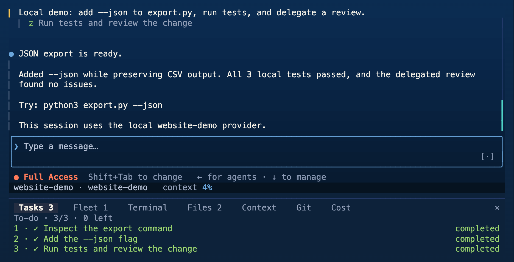
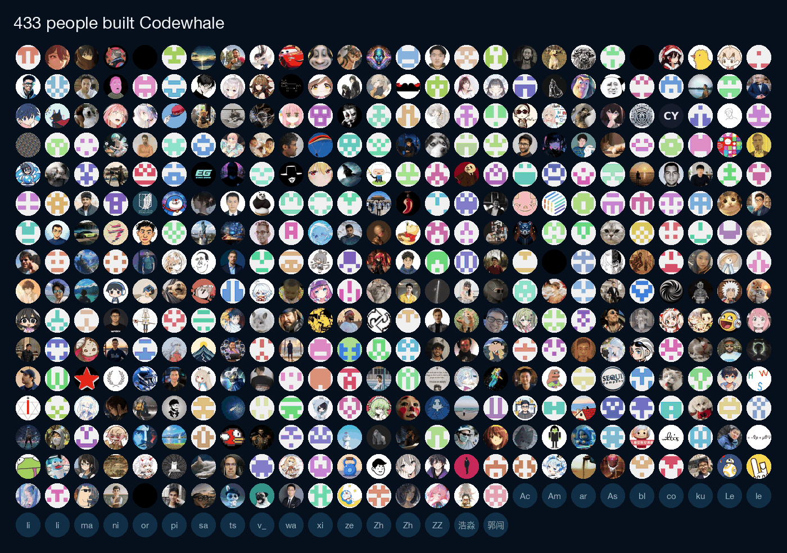

<!-- source: README.md sha256:fd76d718e3a2 -->
<div align="center">

<picture>
  <source media="(prefers-color-scheme: dark)" srcset="../../brand/mark-reversed.svg">
  
</picture>

<h1>El model pot ser de qualsevol. L’agent hauria de ser teu.</h1>

Codewhale és un agent de programació de codi obert per al teu terminal, escrit en Rust. Funciona amb qualsevol model, pot repartir una tasca entre diversos agents i en pots llegir cada línia.

```bash
curl -fsSL https://codewhale.net/install.sh | sh
```

Això instal·la l’última versió a macOS o Linux, i no necessita cap compte. [Windows, npm i Cargo](#installació) són més avall.

[](https://github.com/codewhale-hq/Codewhale/releases/latest)
[](https://github.com/codewhale-hq/Codewhale/actions/workflows/ci.yml)
[](../../LICENSE)
[](https://discord.gg/37gfS3ksug)

[Lloc web](https://codewhale.net) · [Documentació](../README.md) · [Registre de canvis](../../CHANGELOG.md) · [Contribuir](../../CONTRIBUTING.md)

[English](../../README.md) · [简体中文](README.zh-CN.md) · [日本語](README.ja-JP.md) · [Tiếng Việt](README.vi.md) · [Bahasa Indonesia](README.id.md) · [한국어](README.ko-KR.md) · [Español](README.es-419.md) · [Português](README.pt-BR.md) · [Русский](README.ru.md) · [Українська](README.uk.md) · [Français](README.fr.md) · [Deutsch](README.de.md) · [繁體中文](README.zh-TW.md) · [हिन्दी](README.hi.md) · [Türkçe](README.tr.md) · [Italiano](README.it.md) · [Polski](README.pl.md) · [العربية](README.ar.md)

<sub>Aquesta traducció és un esborrany automàtic que encara no ha revisat cap parlant nadiu.</sub>



<sub>Una compilació de desenvolupament de la 0.10.3, que encara no s’ha publicat, amb un model de prova amb guió, en Full Access dins d’un espai de treball d’un sol ús. L’edició, tres proves i una revisió d’un subagent es van executar de debò.</sub>

</div>

## Instal·lació

L’ordre de dalt posa `codewhale`, verificat amb suma de comprovació, i el seu àlies curt `codew` a `~/.local/bin`. Si després la shell diu `command not found`, segueix la nota sobre el PATH que imprimeix l’instal·lador ([detalls](../INSTALL.md#put-it-on-your-path)). `codewhale update` l’actualitza.

```bash
winget install --id HunterBown.CodeWhale --exact --source winget  # Windows x64
npm install -g codewhale                                          # wraps the same release binaries
cargo install codewhale-cli --locked                              # builds from source; can trail GitHub Releases
```

Hi ha binaris precompilats per a Linux, macOS i Windows en x64 i arm64. Scoop, Nix, Homebrew a Linux, Android i Termux (vista prèvia) i les baixades manuals són a la [guia d’instal·lació](../INSTALL.md), i els contenidors a [Docker](../DOCKER.md). Fes servir un sol mètode d’instal·lació per màquina; si no, hi haurà dues còpies al teu `PATH` i guanyarà la primera que es trobi.

## Inici ràpid

1. Fes commit o stash de la teva feina i executa `codewhale` des de l’arrel d’un repositori git. Per defecte aplica els canvis de fitxers del repositori sense preguntar i pregunta abans de cada ordre de shell que no sigui només de lectura.
2. Executa `/provider` (o prem `F3`), tria un proveïdor, enganxa la seva clau d’API i tria un model. DeepSeek és el proveïdor per defecte. En el primer inici sense clau, Codewhale et demana un proveïdor quan envies el primer missatge, i ofereix un model local quan respon un servidor Ollama local.
3. Escriu una tasca:

```text
Fix the failing tests and explain what changed.
```

Les ordres de només lectura s’executen de seguida. Per a qualsevol altra ordre de shell, Codewhale pregunta primer: `y` l’executa una vegada, `a` permet ordres semblants durant la resta de la conversa i `n` la rebutja. `/undo` desfà la teva darrera petició i els seus canvis de fitxers, i `/help` mostra les ordres i les tecles.

Per a scripts i CI, `codewhale exec` executa una tasca sense la interfície. Llegeix [execucions sense interfície](../INSTALL.md#headless-scripts-ci) abans de donar-li eines amb `--auto`, perquè `--auto` fa servir Full Access tret que hi afegeixis un sandbox.

## Què fa

Dona una tasca a Codewhale i llegirà el repositori, editarà fitxers i executarà ordres fins que la tasca estigui feta o necessiti la teva resposta. Les [notes de la darrera versió](https://github.com/codewhale-hq/Codewhale/releases/latest) recullen els canvis més nous, i el [registre de canvis](../../CHANGELOG.md) inclou cada versió.

### Qualsevol model

Porta més de 40 proveïdors integrats, entre ells Anthropic, OpenAI, DeepSeek, Google, Mistral, Moonshot, OpenRouter i xAI. Funciona qualsevol endpoint compatible amb OpenAI, i també els models locals amb Ollama, vLLM o SGLang. El model per defecte és `deepseek-flash` de DeepSeek, que ara serveix DeepSeek V4.1 Flash ([detalls](../PROVIDERS.md#deepseek-v41-flash)).

`/model` canvia de model entre torns, i `/model auto` en tria un per a cada torn (`/router` en defineix la manera). `/turn inspect` mostra quin model ha fet servir un torn, quant ha costat i quant ha trigat. Consulta [Proveïdors](../PROVIDERS.md).

### Rebuts i desfer

`/receipts`, o `codewhale receipts --last` després de sortir, llista els fitxers que ha canviat una sessió, les ordres que ha executat, les crides web i MCP, els agents que ha iniciat, cada aprovació i qui l’ha donada, i el que ha fallat. `/undo` desfà la teva darrera petició i els fitxers que ha canviat en un sol pas. `/restore` torna tot l’espai de treball a una instantània anterior i, com que això sobreescriu les edicions posteriors, necessita `/trust on` o Full Access. Consulta [Rebuts](../RECEIPTS.md).

### Diversos agents en una tasca

`/goal` fixa un objectiu que continua d’un torn a l’altre. Codewhale pot repartir la feina entre [subagents](../SUBAGENTS.md), fer anar una [Fleet](../FLEET.md) d’agents amb rols i models propis, o seguir un [flux de treball](../WORKFLOW_AUTHORING.md) desat al repositori.

### Extensions

Connecta [servidors MCP](../MCP.md), afegeix [skills](../SKILLS.md) i [connectors](../PLUGINS.md), i executa [hooks](../HOOKS.md) en esdeveniments de sessió i d’eines. El mode codi (experimental, activat per defecte) permet que el model escrigui un programa `execute_tools` que crida diverses eines MCP i de connectors; cada crida continua respectant les teves regles d’aprovació i en conserva el rebut. El connector Computer Use inclòs a v0.10.2 (experimental, només macOS) pot observar i fer servir altres aplicacions, i resta apagat fins que en revises l’accés i l’actives ([guia](https://github.com/codewhale-hq/Codewhale/blob/v0.10.2/crates/tui/plugins/computer-use/README.md)). Arriba amb 0.10.3: el connector es publica [per separat](https://github.com/codewhale-hq/codewhale-cu-plugin).

### Maneres d’executar-lo

| Ordre | Què fa |
| --- | --- |
| `codewhale` | L’aplicació interactiva de terminal |
| `codewhale exec "…"` | Una tasca sense la interfície, per a scripts i CI ([execucions sense interfície](../INSTALL.md#headless-scripts-ci)) |
| `codewhale web` | Un client web local a `127.0.0.1` ([guia](../WEB.md)) |
| `codewhale review --pr N` | Una revisió orientativa d’una pull request de GitHub; la [configuració del bot de GitHub](../GITHUB_ACTION.md#set-up-your-own-bot) l’executa amb la teva pròpia clau de model |
| `codewhale app-server --http` | La [Runtime API](../RUNTIME_API.md), una API HTTP local per a fils, esdeveniments, aprovacions i els canvis de fitxers de cada torn |
| `codewhale serve --acp` | L’Agent Client Protocol sobre stdio, per a editors com Zed |

L’aplicació de terminal, `exec`, `web` i la Runtime API comparteixen un sol motor ([arquitectura](../ARCHITECTURE.md)). Una [extensió per a VS Code](https://marketplace.visualstudio.com/items?itemName=HengQuWorld.brotherwhale-vscode) mantinguda per la comunitat s’hi connecta des de la barra lateral ([codi font](https://github.com/HengQuWorld/CodeWhale-VSCode)).

## Com es manté segur

Dos interruptors diuen quant pot fer Codewhale pel seu compte. Amb l’entrada buida, `Tab` canvia el mode: **Plan** llegeix i cerca però no canvia res, **Work** edita fitxers i executa ordres, i **Operate** té el mateix accés que Work i continua fins que l’objectiu queda verificat o et necessita. `Shift+Tab` canvia el permís. **Ask**, el predeterminat, aplica els canvis de fitxers del teu repositori sense preguntar i pregunta abans de les ordres de shell que no són només de lectura. **Auto-Review** deixa que regles i un model revisor aprovin les crides rutinàries i rebutja les d’alt risc; canvia a Ask per aprovar-les tu. **Full Access** no pregunta mai i desactiva el sandbox de Codewhale, tot i que les regles del repositori i la política gestionada continuen vigents. La [guia de v0.10.2](https://github.com/codewhale-hq/Codewhale/blob/v0.10.2/docs/MODES.md) té els detalls.

Arriba amb 0.10.3: `Shift+Tab` esdevé un únic selector que passa per Ask, Accept Edits, Plan, Auto-Review i Full Access, `Tab` deixa de canviar el mode i Operate es retira. Ask preguntarà també abans de cada canvi de fitxer, i el nou predeterminat, Accept Edits, aplicarà els canvis dins del repositori git i continuarà preguntant abans de les ordres. La [guia actual](../MODES.md) ho descriu.

A Ask i Auto-Review, les ordres s’executen en un sandbox del sistema operatiu quan el sistema en té un: Seatbelt a macOS, i bubblewrap a Linux quan està instal·lat. Windows encara no té sandbox del sistema, i Full Access apaga el sandbox. Dins del sandbox, les ordres de shell i les sessions de terminal no poden llegir magatzems de credencials com `~/.ssh`, `~/.aws` i els fitxers `.env`. `/preview-request` mostra una previsualització censurada de la propera petició sense enviar-la.

No necessites cap compte, i les claus que afegeixes amb `/provider` es queden a la teva màquina. Amb la teva pròpia clau d’API pagues directament el proveïdor, i els models locals no necessiten clau. El peu de pàgina i `/cost` mostren quant ha costat una sessió quan se’n coneix el preu, i un preu desconegut es mostra com a desconegut, mai com a gratuït.

La telemetria està activada per defecte. Envia recomptes agregats (versió i plataforma, durada i resultat de la sessió, quins proveïdors integrats has fet servir, recomptes de funcions i d’errors) amb un identificador d’instal·lació aleatori que canvia cada 90 dies, i mai converses, codi, prompts, noms de models, noms de fitxers o repositoris, ni credencials. Aquesta ordre la desactiva:

```bash
codewhale config set telemetry false
```

En arrencar, Codewhale també comprova a GitHub si hi ha una versió nova; defineix `CODEWHALE_NO_UPDATE_CHECK=1` per ometre-ho. Més informació a [ordre d’autorització](../AUTHORIZATION_ORDER.md), [sandbox](../SANDBOX.md) i [telemetria](../TELEMETRY.md).

## Cap on va

Codewhale s’està convertint en un únic entorn que abasta el teu terminal, una aplicació d’escriptori, el navegador i ordinadors al núvol, tot mogut per un sol motor. Cada part de sota diu on es troba avui.

| Part | Estat | Avui |
| --- | --- | --- |
| Aplicació de terminal | Publicat | Instal·la-la a macOS, Linux o Windows i executa `codewhale` a qualsevol repositori. |
| Client de navegador local | Publicat | Executa `codewhale web` per llegir la conversa, enviar una tasca i respondre a les aprovacions al navegador; ve amb el terminal i no necessita cap compte. |
| Molts agents en una tasca | Publicat | Els subagents, les Fleets i els fluxos de treball permeten que diversos agents comparteixin una tasca, cadascun amb el seu rol. |
| Aplicació d’escriptori | En desenvolupament, sense descàrrega | Estem construint una aplicació d’escriptori sobre el mateix motor, i encara no té cap descàrrega pública. |
| Ordinadors al núvol | Només per invitació | Els ordinadors al núvol són només per invitació, i els estem construint perquè una sessió pugui continuar treballant en una màquina al núvol. |
| Una sessió a través de tots | En construcció | Estem construint una sessió que t’acompanya del terminal a l’escriptori, al navegador i al núvol, i continua sent teva tot el camí. |

El [full de ruta](../ROADMAP.md) diu què cobreix cada versió i on pots ajudar.

## Si vens d’un altre agent

Codewhale llegeix `AGENTS.md` pel seu compte. Els fitxers d’instruccions escrits per a altres eines, com ara `CLAUDE.md`, `.cursorrules` o `.github/copilot-instructions.md`, només es carreguen si els actives amb `project_instruction_imports = ["claude"]` (o `"cursor"`, `"cline"`, `"windsurf"`, `"copilot"`, `"all"`) a la configuració; consulta [config.example.toml](../../config.example.toml). Codewhale t’avisa quan en troba un que no ha carregat.

`/import-claude` prepara una importació de la teva configuració de Claude Code i dels servidors MCP perquè la revisis. `/plugin install` accepta connectors de Claude Code que contenen skills, ordres, perfils d’agent i servidors MCP, i rebutja els que necessiten hooks o servidors LSP ([detalls](../CLAUDE_PLUGIN_COMPAT.md)).

## Documentació

Aquestes guies segueixen la branca principal i poden descriure canvis que encara no són a l’última versió.

| Comença aquí | Referència |
| --- | --- |
| [Guia d’usuari](../GUIDE.md) | [Configuració](../CONFIGURATION.md) |
| [Instal·lació](../INSTALL.md) | [Arquitectura](../ARCHITECTURE.md) |
| [Proveïdors i models locals](../PROVIDERS.md) | [Runtime API](../RUNTIME_API.md) |
| [Modes i permisos](../MODES.md) | [Escriure connectors](../PLUGIN_AUTHORING.md) |
| [Dreceres de teclat](../KEYBINDINGS.md) | [Rebuts](../RECEIPTS.md) |
| [Revisió de pull requests a GitHub](../GITHUB_ACTION.md) | [Tota la documentació](../README.md) |

## Contribuir

Codewhale es construeix en obert per les persones que l’utilitzen, en moltes llengües.

<a href="../CONTRIBUTORS.md#everyone"></a>

El [mur de contribuïdors](../CONTRIBUTORS.md) compta totes les persones el codi, els commits en coautoria, les pull requests represes o els informes acreditats de les quals són a Codewhale, incloses les que la llista de contribuïdors de GitHub no mostra. `scripts/contributor-wall.py` torna a generar la imatge i la llista a partir de l’historial de git i de GitHub.

Tota opinió és benvinguda: un error, una idea o alguna cosa que semblava o feia l’efecte d’estar malament. [Obre una issue](https://github.com/codewhale-hq/Codewhale/issues/new/choose) per a qualsevol d’aquestes coses; una issue també és el millor lloc per començar una funció nova. Les pull requests són benvingudes per a correccions, traduccions, proveïdors i feina planificada. Les preguntes van a [Discussions](https://github.com/codewhale-hq/Codewhale/discussions). La [guia de contribució](../../CONTRIBUTING.md) mostra on va cada tipus d’ajuda, com entra la teva feina amb el teu nom i [on és cada cosa](../../CONTRIBUTING.md#project-structure).

Xerra a [Discord](https://discord.gg/37gfS3ksug), o afegeix el mantenidor, Hunter, a WeChat (`hunterbown`) i demana entrar al grup Whale Brothers. Tothom hi és benvingut.

## Història i llicència

Codewhale va començar com a `deepseek-tui` i encara llegeix la configuració i les sessions d’aquell projecte. Es manté de manera independent i no està afiliat a DeepSeek ni a cap altre proveïdor de models.

[MIT](../../LICENSE). El codi adaptat d’altres projectes de codi obert apareix als avisos de tercers per a les [fonts incloses](../../THIRD_PARTY_NOTICES.md) i els [dissenys adaptats](../THIRD_PARTY_NOTICES.md).
