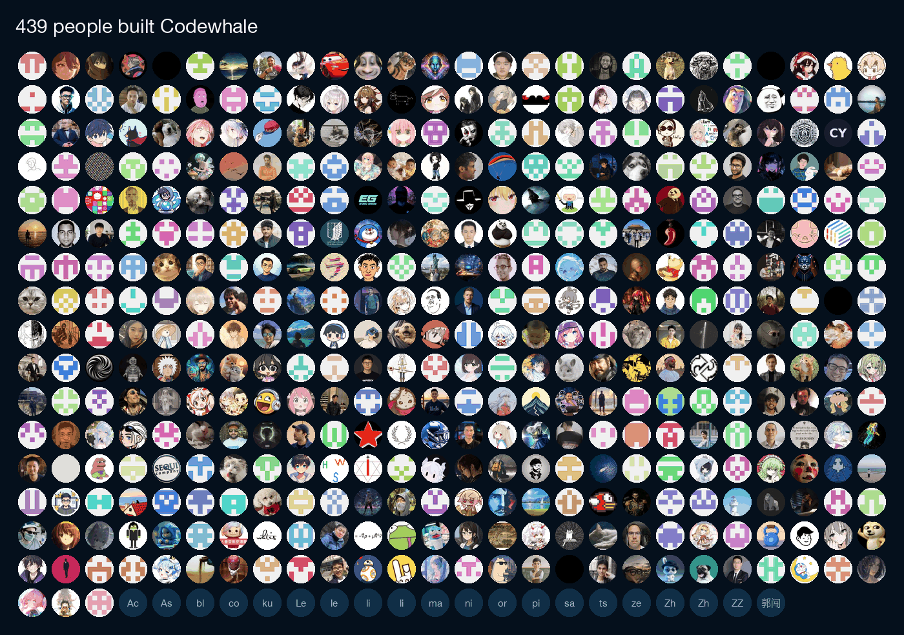

<!-- source: README.md sha256:7e0e7ebc680b -->
<div align="center">

<picture>
  <source media="(prefers-color-scheme: dark)" srcset="../../brand/wordmark-inverted.svg">
  
</picture>

**Agent de programmation open source en Rust pour votre terminal. N’importe quel modèle, flottes multi-agents, sandboxing système et reçus vérifiables.**

```bash
curl -fsSL https://codewhale.net/install.sh | sh
```

[](https://github.com/codewhale-hq/Codewhale/releases/latest)
[](https://github.com/codewhale-hq/Codewhale/actions/workflows/ci.yml)
[](https://crates.io/crates/codewhale-cli)
[](https://www.npmjs.com/package/codewhale)
[](../../LICENSE)
[](https://discord.gg/37gfS3ksug)

[Site web](https://codewhale.net) · [Documentation](../README.md) · [Journal des modifications](../../CHANGELOG.md) · [Contribuer](../../CONTRIBUTING.md)

[English](../../README.md) · [简体中文](README.zh-CN.md) · [日本語](README.ja-JP.md) · [Tiếng Việt](README.vi.md) · [Bahasa Indonesia](README.id.md) · [한국어](README.ko-KR.md) · [Español](README.es-419.md) · [Português](README.pt-BR.md) · [Русский](README.ru.md) · [Українська](README.uk.md) · Français · [Deutsch](README.de.md) · [繁體中文](README.zh-TW.md) · [हिन्दी](README.hi.md) · [Türkçe](README.tr.md) · [Italiano](README.it.md) · [Polski](README.pl.md) · [العربية](README.ar.md) · [Català](README.ca.md)


<sub>Session réelle sur la version publiée Codewhale v0.10.4 (48669ad108fa) avec Ollama local (qwen3:4b) en mode Accept Edits.</sub>

</div>

## Installation

Le script d’installation ci-dessus installe le binaire vérifié par somme de contrôle `codewhale` et son alias court `codew` dans `~/.local/bin` sur macOS et Linux. Si votre shell renvoie `command not found`, ajoutez `~/.local/bin` à votre `PATH` ([détails](../INSTALL.md#put-it-on-your-path)). Mettez à jour sur place avec `codewhale update`.

```bash
winget install --id HunterBown.CodeWhale --exact --source winget  # Windows x64
npm install -g codewhale                                          # wraps the same release binaries
cargo install codewhale-cli --locked                              # builds from source; can trail GitHub Releases
```

Des binaires précompilés sont fournis pour Linux, macOS et Windows (x64 et arm64). Scoop, Nix, Homebrew sous Linux, Android/Termux (aperçu) et les téléchargements manuels figurent dans [docs/INSTALL.md](../INSTALL.md) ; les images de conteneur sont dans [docs/DOCKER.md](../DOCKER.md). Utilisez une seule méthode d’installation par machine afin d’éviter qu’un binaire n’en masque un autre dans le `PATH`.

## Démarrage rapide

1. Commitez ou mettez de côté votre travail avec `git stash`, puis lancez `codewhale` à la racine d’un dépôt git.
2. Exécutez `/provider` (ou appuyez sur `F3`) pour choisir un fournisseur, coller une clé API et sélectionner un modèle. DeepSeek est le choix par défaut ; si aucune clé n’est configurée et qu’un serveur Ollama local répond, Codewhale propose ses modèles dès votre premier message.
3. Donnez-lui une tâche :

```text
Fix the failing tests and explain what changed.
```

Les commandes en lecture seule s’exécutent immédiatement. Les commandes shell qui modifient le système demandent confirmation : `y` exécute une fois, `a` autorise les commandes correspondantes pour le reste de la session et `n` refuse. Utilisez `/undo` pour annuler le dernier tour et ses modifications de fichiers, ou `/help` pour les commandes et raccourcis clavier.

## Fonctionnalités

- **Plus de 50 fournisseurs intégrés et modèles locaux :** Anthropic, OpenAI, DeepSeek (`deepseek-flash` / V4.1 Flash par défaut ; [détails](../PROVIDERS.md#deepseek-v41-flash)), Google, Mistral, Moonshot, OpenRouter, xAI, tout point de terminaison compatible OpenAI et les moteurs locaux via Ollama, vLLM ou SGLang. Changez de modèle en cours de session avec `/model`, routez par tour avec `/model auto` (`/router`) et examinez la latence et le coût avec `/turn inspect`. Voir [Fournisseurs](../PROVIDERS.md).
- **Reçus et retour arrière :** `/receipts` (ou `codewhale receipts --last` après fermeture) consigne les fichiers modifiés, commandes, appels web/MCP, sous-agents, approbations et échecs. `/undo` annule le dernier tour en une étape ; `/restore` restaure l’espace de travail à un instantané antérieur (nécessite `/trust on` ou Full Access). Voir [Reçus](../RECEIPTS.md).
- **Sous-agents, Fleets et workflows :** Suivez des objectifs sur plusieurs tours avec `/goal`, déléguez à des [sous-agents](../SUBAGENTS.md), coordonnez des [Fleets](../FLEET.md) par rôle et par modèle ou exécutez des [workflows](../WORKFLOW_AUTHORING.md) suivis dans le dépôt.
- **MCP, skills, hooks et plugins :** Connectez des [serveurs MCP](../MCP.md), [skills](../SKILLS.md), [plugins](../PLUGINS.md) et [hooks](../HOOKS.md) de cycle de vie. Le mode code expérimental (`execute_tools`) regroupe plusieurs appels MCP ou plugin sous vos règles d’approbation habituelles. L’extension macOS optionnelle [Computer Use](https://github.com/codewhale-hq/codewhale-cu-plugin) reste désactivée tant qu’elle n’est pas explicitement vérifiée et activée.
- **Compatibilité directe :** Lit automatiquement `AGENTS.md`. Activez `CLAUDE.md`, `.cursorrules` ou `.github/copilot-instructions.md` via `project_instruction_imports` dans [config.example.toml](../../config.example.toml). Importez les réglages et serveurs MCP de Claude Code avec `/import-claude`, ou installez des plugins Claude Code (skills, commandes, profils d’agent, MCP) et DeepSeek Harness (DSH) avec `/plugin install` ([détails](../CLAUDE_PLUGIN_COMPAT.md)).

## Points d’entrée

| Commande | Rôle |
| --- | --- |
| `codewhale` | Application interactive en terminal |
| `codewhale exec "…"` | Exécuteur sans interface pour scripts et CI ([guide](../INSTALL.md#headless-scripts-ci) ; `--auto` utilise Full Access sauf en sandbox) |
| `codewhale web` | Client web local sur `127.0.0.1` ([guide](../WEB.md)) |
| `codewhale review --pr N` | Revue consultative de PR GitHub ; [configuration de bot GitHub](../GITHUB_ACTION.md#set-up-your-own-bot) avec votre propre clé |
| `codewhale app-server --http` | [Runtime API](../RUNTIME_API.md) HTTP locale pour fils, événements, approbations et diffs par tour |
| `codewhale serve --acp` | Agent Client Protocol sur stdio pour des éditeurs comme Zed |

Tous les points d’entrée partagent un seul moteur Rust ([architecture](../ARCHITECTURE.md)). Une [extension VS Code](https://marketplace.visualstudio.com/items?itemName=HengQuWorld.brotherwhale-vscode) maintenue par la communauté ([source](https://github.com/HengQuWorld/CodeWhale-VSCode)) se connecte au même moteur. Consultez les [dernières notes de version](https://github.com/codewhale-hq/Codewhale/releases/latest) et la [feuille de route](../ROADMAP.md) pour l’état actuel des versions, du client bureau et du cloud.

## Permissions, sandboxing et confidentialité

`Shift+Tab` fait défiler les modes de permission : **Ask → Accept Edits → Plan → Auto-Review → Full Access** (`Tab` ne fait que compléter). **Accept Edits** (par défaut) applique les éditions dans le dépôt git et demande confirmation avant les commandes. **Ask** demande confirmation à chaque édition et commande. **Plan** est en lecture seule. **Auto-Review** combine des règles et un modèle vérificateur pour approuver les appels courants et bloquer ceux à risque. **Full Access** supprime les confirmations et désactive le sandbox système (les règles du dépôt et la politique gérée restent actives). Voir [Modes](../MODES.md).

Dans Ask, Accept Edits et Auto-Review, les commandes tournent dans un sandbox système lorsque disponible : Seatbelt sur macOS et bubblewrap sur Linux (Windows ne dispose pas encore de sandbox système). Les commandes isolées et les sessions terminal ne peuvent pas lire les emplacements de secrets tels que `~/.ssh`, `~/.aws` ou les fichiers `.env`. Utilisez `/preview-request` pour inspecter une requête sortante expurgée avant son envoi.

Les clés API ajoutées avec `/provider` restent sur votre machine, et les modèles locaux ne demandent aucune clé. `/cost` et le pied de page suivent le coût de la session lorsque le tarif est connu (un tarif inconnu est affiché comme inconnu, jamais comme gratuit).

La télémétrie agrégée est activée par défaut (version, OS, durée/issue de session, identifiants de fournisseurs intégrés, identifiants de modèles du catalogue public intégré (les modèles personnalisés, privés ou locaux sont enregistrés comme `other`), totaux de jetons, compteurs d'appels/erreurs d'outils intégrés et compteurs de fonctionnalités/erreurs ; identifiant d'installation aléatoire renouvelé tous les 90 jours ; jamais de code, prompts, conversations, noms de modèles personnalisés/privés, noms de fichiers/dépôts/branches, identifiants ou adresses IP). Désactivez-la avec :

```bash
codewhale config set telemetry false
```

Au démarrage, Codewhale vérifie aussi les nouvelles versions sur GitHub (`CODEWHALE_NO_UPDATE_CHECK=1` pour ignorer) et actualise le catalogue public `models.dev` toutes les 24 heures (`CODEWHALE_DISABLE_MODELS_DEV_FETCH=1` ou `[catalog] auto_refresh = false` pour ignorer ; désactivé automatiquement en CI et sous `DO_NOT_TRACK`). Détails : [ordre d'autorisation](../AUTHORIZATION_ORDER.md), [sandboxing](../SANDBOX.md) et [télémétrie](../TELEMETRY.md).

## Documentation

Les guides suivent `main` et peuvent décrire des changements qui ne figurent pas encore dans la dernière version publiée.

| Pour commencer | Référence |
| --- | --- |
| [Guide utilisateur](../GUIDE.md) | [Configuration](../CONFIGURATION.md) |
| [Installation](../INSTALL.md) | [Architecture](../ARCHITECTURE.md) |
| [Fournisseurs et modèles locaux](../PROVIDERS.md) | [Runtime API](../RUNTIME_API.md) |
| [Modes et permissions](../MODES.md) | [Création de plugins](../PLUGIN_AUTHORING.md) |
| [Raccourcis clavier](../KEYBINDINGS.md) | [Reçus](../RECEIPTS.md) |
| [Revue de pull requests GitHub](../GITHUB_ACTION.md) | [Toute la documentation](../README.md) |

## Contribuer et licence

<a href="../CONTRIBUTORS.md#everyone"></a>

Le [mur des contributeurs](../CONTRIBUTORS.md) (`scripts/contributor-wall.py`) recense le code, les commits co-signés, les PR reprises et les signalements crédités. Les rapports de bugs et propositions d’évolutions vont dans [Issues](https://github.com/codewhale-hq/Codewhale/issues/new/choose), les questions dans [Discussions](https://github.com/codewhale-hq/Codewhale/discussions), et les règles de PR ainsi que l’organisation du projet sont dans [CONTRIBUTING.md](../../CONTRIBUTING.md) ([structure du projet](../../CONTRIBUTING.md#project-structure)). Rejoignez-nous sur [Discord](https://discord.gg/37gfS3ksug) ou ajoutez `hunterbown` sur WeChat pour le groupe Whale Brothers.

Codewhale a débuté sous le nom `deepseek-tui` et reste rétrocompatible avec sa configuration et ses sessions. Il est maintenu de manière indépendante et n’est affilié ni à DeepSeek ni à aucun autre fournisseur de modèles.

[MIT](../../LICENSE). Mentions tierces : [sources incluses](../../THIRD_PARTY_NOTICES.md) et [conceptions adaptées](../THIRD_PARTY_NOTICES.md).
