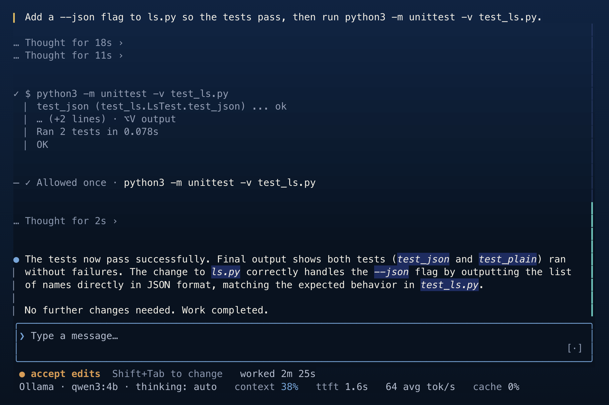

<!-- source: README.md sha256:308ec0b2a2e8 -->
<div align="center">

<picture>
  <source media="(prefers-color-scheme: dark)" srcset="../../brand/wordmark-inverted.svg">
  
</picture>

**Agen pemrograman Rust bersumber terbuka untuk terminal Anda. Model apa pun, armada multi-agen, sandbox OS, dan bukti kerja yang dapat diverifikasi.**

```bash
curl -fsSL https://codewhale.net/install.sh | sh
```

[](https://github.com/codewhale-hq/Codewhale/releases/latest)
[](https://github.com/codewhale-hq/Codewhale/actions/workflows/ci.yml)
[](https://crates.io/crates/codewhale-cli)
[](https://www.npmjs.com/package/codewhale)
[](../../LICENSE)
[](https://discord.gg/37gfS3ksug)

[Situs web](https://codewhale.net) · [Dokumentasi](../README.md) · [Catatan perubahan](../../CHANGELOG.md) · [Berkontribusi](../../CONTRIBUTING.md)

[English](../../README.md) · [简体中文](README.zh-CN.md) · [日本語](README.ja-JP.md) · [Tiếng Việt](README.vi.md) · [한국어](README.ko-KR.md) · [Español](README.es-419.md) · [Português](README.pt-BR.md) · [Русский](README.ru.md) · [Українська](README.uk.md) · [Français](README.fr.md) · [Deutsch](README.de.md) · [繁體中文](README.zh-TW.md) · [हिन्दी](README.hi.md) · [Türkçe](README.tr.md) · [Italiano](README.it.md) · [Polski](README.pl.md) · [العربية](README.ar.md) · [Català](README.ca.md)

<sub>Terjemahan ini adalah draf mesin yang belum ditinjau oleh penutur asli.</sub>



<sub>Sesi nyata pada rilis Codewhale v0.10.4 (48669ad108fa) yang menjalankan Ollama lokal (qwen3:4b) dalam mode Accept Edits.</sub>

</div>

## Pemasangan

Skrip pemasangan di atas menempatkan `codewhale` yang terverifikasi checksum beserta alias singkatnya `codew` di `~/.local/bin` pada macOS dan Linux. Jika shell menampilkan `command not found`, tambahkan `~/.local/bin` ke `PATH` ([detail](../INSTALL.md#put-it-on-your-path)). Perbarui langsung dengan `codewhale update`.

```bash
winget install --id HunterBown.CodeWhale --exact --source winget  # Windows x64
npm install -g codewhale                                          # wraps the same release binaries
cargo install codewhale-cli --locked                              # builds from source; can trail GitHub Releases
```

Biner siap pakai tersedia untuk Linux, macOS, dan Windows (x64 dan arm64). Scoop, Nix, Homebrew di Linux, Android/Termux (pratinjau), dan unduhan manual ada di [docs/INSTALL.md](../INSTALL.md); citra kontainer ada di [docs/DOCKER.md](../DOCKER.md). Gunakan satu metode pemasangan per mesin agar dua biner tidak saling menutupi di `PATH`.

## Mulai cepat

1. Commit atau stash pekerjaan Anda, lalu jalankan `codewhale` dari root repositori git.
2. Jalankan `/provider` (atau tekan `F3`) untuk memilih penyedia, menempelkan kunci API, dan memilih model. DeepSeek adalah bawaan; jika tidak ada kunci yang diatur dan server Ollama lokal merespons, Codewhale menawarkan model lokalnya pada pesan pertama Anda.
3. Berikan tugas:

```text
Fix the failing tests and explain what changed.
```

Perintah baca-saja langsung berjalan, kecuali di Ask, yang bertanya sebelum setiap perintah. Perintah shell yang mengubah keadaan meminta persetujuan: `y` menjalankan sekali, `a` mengizinkan perintah serupa untuk sisa sesi, dan `n` menolak. Jalankan `/undo` untuk membatalkan giliran terakhir beserta perubahan berkasnya, atau `/help` untuk daftar perintah dan pintasan.

## Kemampuan

- **50+ penyedia bawaan dan model lokal:** Anthropic, OpenAI, DeepSeek (bawaan `deepseek-flash` / V4.1 Flash; [detail](../PROVIDERS.md#deepseek-v41-flash)), Google, Mistral, Moonshot, OpenRouter, xAI, endpoint apa pun yang kompatibel dengan OpenAI, serta runtime lokal melalui Ollama, vLLM, atau SGLang. Ganti model di tengah sesi dengan `/model`, arahkan per giliran dengan `/model auto` (`/router`), dan periksa latensi serta biaya dengan `/turn inspect`. Lihat [Penyedia](../PROVIDERS.md).
- **Bukti kerja dan pemulihan:** `/receipts` (atau `codewhale receipts --last` setelah keluar) mencatat berkas yang diubah, perintah yang dijalankan, panggilan web/MCP, sub-agen, persetujuan, dan kegagalan. `/undo` membatalkan giliran terakhir dalam satu langkah; `/restore` mengembalikan workspace ke snapshot sebelumnya (memerlukan `/trust on` atau Full Access). Lihat [Bukti kerja](../RECEIPTS.md).
- **Sub-agen, Fleet, dan alur kerja:** Pertahankan tujuan lintas giliran dengan `/goal`, delegasikan pekerjaan ke [sub-agen](../SUBAGENTS.md), koordinasikan [Fleet](../FLEET.md) sesuai peran dan model, atau jalankan [alur kerja](../WORKFLOW_AUTHORING.md) yang tersimpan di repositori.
- **MCP, skill, hook, dan plugin:** Hubungkan [server MCP](../MCP.md), [skill](../SKILLS.md), [plugin](../PLUGINS.md), dan [hook](../HOOKS.md) siklus hidup. Mode kode eksperimental (`execute_tools`) menggabungkan beberapa panggilan MCP/plugin di bawah aturan persetujuan normal Anda. Plugin opsional macOS [Computer Use](https://github.com/codewhale-hq/codewhale-cu-plugin) tetap nonaktif hingga Anda meninjau aksesnya dan mengaktifkannya.
- **Kompatibilitas langsung:** Membaca `AGENTS.md` secara otomatis. Aktifkan `CLAUDE.md`, `.cursorrules`, atau `.github/copilot-instructions.md` melalui `project_instruction_imports` di [config.example.toml](../../config.example.toml). Impor pengaturan dan server MCP Claude Code dengan `/import-claude`, atau pasang plugin Claude Code (skill, perintah, profil agen, MCP) dan plugin DeepSeek Harness (DSH) dengan `/plugin install` ([detail](../CLAUDE_PLUGIN_COMPAT.md)).

## Cara menjalankan

| Perintah | Tujuan |
| --- | --- |
| `codewhale` | Aplikasi terminal interaktif |
| `codewhale exec "…"` | Pelaksana satu tugas tanpa antarmuka untuk skrip dan CI ([panduan](../INSTALL.md#headless-scripts-ci); `--auto` memakai Full Access kecuali diberi sandbox) |
| `codewhale web` | Klien web lokal di `127.0.0.1` ([panduan](../WEB.md)) |
| `codewhale review --pr N` | Tinjauan PR GitHub bersifat saran; [pengaturan bot GitHub](../GITHUB_ACTION.md#set-up-your-own-bot) berjalan dengan kunci Anda sendiri |
| `codewhale app-server --http` | [Runtime API](../RUNTIME_API.md) HTTP lokal untuk thread, event, persetujuan, dan diff per giliran |
| `codewhale serve --acp` | Agent Client Protocol melalui stdio untuk editor seperti Zed |

Semua titik masuk berbagi satu mesin Rust ([arsitektur](../ARCHITECTURE.md)). [Ekstensi VS Code](https://marketplace.visualstudio.com/items?itemName=HengQuWorld.brotherwhale-vscode) yang dikelola komunitas ([sumber](https://github.com/HengQuWorld/CodeWhale-VSCode)) terhubung ke mesin yang sama. Lihat [catatan rilis terbaru](https://github.com/codewhale-hq/Codewhale/releases/latest) dan [peta jalan](../ROADMAP.md) untuk status rilis dan desktop/cloud saat ini.

## Izin, sandbox, dan privasi

`Shift+Tab` mengganti mode izin: **Ask → Accept Edits → Plan → Auto-Review → Full Access** (`Tab` hanya untuk pelengkapan). **Accept Edits** (bawaan) menerapkan suntingan di dalam repositori git dan bertanya sebelum menjalankan perintah. **Ask** bertanya pada setiap suntingan dan perintah. **Plan** hanya-baca. **Auto-Review** memakai aturan dan model peninjau untuk menyetujui panggilan rutin serta memblokir tindakan berisiko tinggi. **Full Access** melewati konfirmasi dan menonaktifkan sandbox OS (aturan repositori dan kebijakan terkelola tetap berlaku). Lihat [Mode](../MODES.md).

Pada Ask, Accept Edits, dan Auto-Review, perintah berjalan di dalam sandbox OS jika tersedia: Seatbelt di macOS dan bubblewrap di Linux (Windows belum memiliki sandbox OS). Perintah dan sesi terminal di dalam sandbox tidak dapat membaca jalur kredensial seperti `~/.ssh`, `~/.aws`, atau berkas `.env`. Jalankan `/preview-request` untuk memeriksa permintaan keluar yang telah disamarkan sebelum mengirimkannya.

Kunci API yang ditambahkan melalui `/provider` tetap berada di mesin Anda, dan model lokal tidak memerlukan kunci. `/cost` dan footer melacak biaya sesi saat harga diketahui (harga yang tidak diketahui ditampilkan sebagai tidak diketahui, tidak pernah sebagai gratis).

Telemetri agregat aktif secara bawaan (versi, OS, durasi/hasil sesi, ID penyedia bawaan, ID model katalog publik bawaan (model kustom, privat, atau lokal dicatat sebagai `other`), total token, hitungan panggilan/galat alat bawaan, dan penghitung fitur/galat; ID pemasangan acak yang berganti setiap 90 hari; tidak pernah kode, prompt, percakapan, nama model kustom/privat, nama berkas/repo/cabang, kredensial, atau alamat IP). Nonaktifkan dengan:

```bash
codewhale config set telemetry false
```

Saat mulai, Codewhale juga memeriksa rilis baru di GitHub (`CODEWHALE_NO_UPDATE_CHECK=1` untuk melewati) dan menyegarkan katalog model publik `models.dev` setiap 24 jam (`CODEWHALE_DISABLE_MODELS_DEV_FETCH=1` atau `[catalog] auto_refresh = false` untuk melewati; dinonaktifkan otomatis di CI dan saat `DO_NOT_TRACK` aktif). Detail: [urutan otorisasi](../AUTHORIZATION_ORDER.md), [sandbox](../SANDBOX.md), dan [telemetri](../TELEMETRY.md).

## Dokumentasi

Panduan mengikuti cabang `main` dan dapat menjelaskan perubahan yang belum ada di rilis terbaru.

| Mulai di sini | Referensi |
| --- | --- |
| [Panduan pengguna](../GUIDE.md) | [Konfigurasi](../CONFIGURATION.md) |
| [Pemasangan](../INSTALL.md) | [Arsitektur](../ARCHITECTURE.md) |
| [Penyedia dan model lokal](../PROVIDERS.md) | [Runtime API](../RUNTIME_API.md) |
| [Mode dan izin](../MODES.md) | [Penulisan plugin](../PLUGIN_AUTHORING.md) |
| [Pintasan keyboard](../KEYBINDINGS.md) | [Bukti kerja](../RECEIPTS.md) |
| [Tinjauan PR GitHub](../GITHUB_ACTION.md) | [Semua dokumentasi](../README.md) |

## Berkontribusi dan lisensi

<a href="../CONTRIBUTORS.md#everyone"></a>

[Dinding kontributor](../CONTRIBUTORS.md) (`scripts/contributor-wall.py`) mencatat kode, commit rekan penulis, PR lanjutan, dan laporan yang diberi kredit. Laporan bug dan usulan fitur dikirim ke [Issues](https://github.com/codewhale-hq/Codewhale/issues/new/choose), pertanyaan ke [Discussions](https://github.com/codewhale-hq/Codewhale/discussions), serta panduan PR dan struktur ada di [CONTRIBUTING.md](../../CONTRIBUTING.md) ([struktur proyek](../../CONTRIBUTING.md#project-structure)). Bergabunglah di [Discord](https://discord.gg/37gfS3ksug) atau tambahkan `hunterbown` di WeChat untuk grup Whale Brothers.

Codewhale berawal dari `deepseek-tui` dan tetap kompatibel ke belakang dengan konfigurasi serta sesinya. Proyek ini dikelola secara independen dan tidak berafiliasi dengan DeepSeek atau penyedia model lainnya.

[MIT](../../LICENSE). Pemberitahuan pihak ketiga: [sumber bawaan](../../THIRD_PARTY_NOTICES.md) dan [desain adaptasi](../THIRD_PARTY_NOTICES.md).
