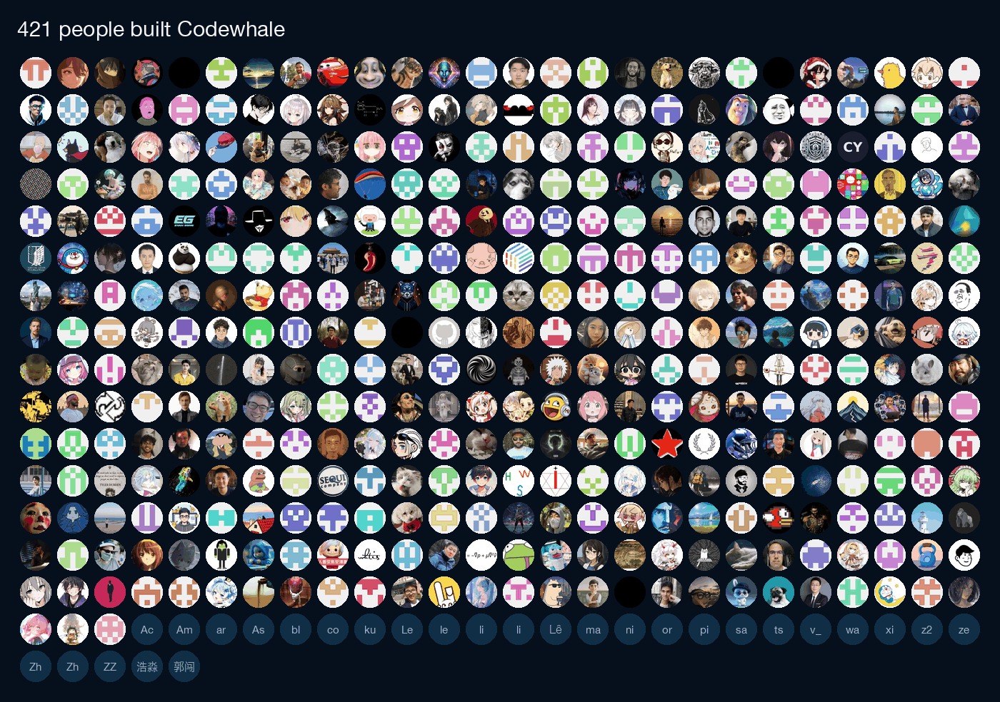

<!-- source: README.md sha256:0430d94f3d47 -->
<div align="center">

<picture>
  <source media="(prefers-color-scheme: dark)" srcset="../../brand/wordmark-inverted.svg">
  
</picture>

**Un agente di programmazione open source per il terminale che funziona con qualsiasi modello.**

Dai un compito a Codewhale: legge il repository, modifica i file ed esegue
comandi finché il compito non è completato o finché non ha bisogno di un tuo
input. Funziona con più di 40 provider integrati, DeepSeek V4.1 Flash come
predefinito, e con modelli eseguiti sulla tua macchina. `/receipts` elenca i
file che ha modificato, i comandi che ha eseguito e le chiamate web e MCP che ha
fatto.

[](https://github.com/codewhale-hq/CodeWhale/actions/workflows/ci.yml)
[](https://crates.io/crates/codewhale-cli)
[](https://www.npmjs.com/package/codewhale)
[](../../LICENSE)
[](https://discord.gg/37gfS3ksug)

[Sito web](https://codewhale.net) · [Documentazione](../README.md) · [Changelog](../../CHANGELOG.md) · [Contribuire](../../CONTRIBUTING.md)

[English](../../README.md) · [简体中文](README.zh-CN.md) · [日本語](README.ja-JP.md) · [Tiếng Việt](README.vi.md) · [Bahasa Indonesia](README.id.md) · [한국어](README.ko-KR.md) · [Español](README.es-419.md) · [Português](README.pt-BR.md) · [Русский](README.ru.md) · [Українська](README.uk.md) · [Français](README.fr.md) · [Deutsch](README.de.md) · [繁體中文](README.zh-TW.md) · [हिन्दी](README.hi.md) · [Türkçe](README.tr.md) · [Polski](README.pl.md) · [العربية](README.ar.md) · [Català](README.ca.md)


<sub>Una build di sviluppo della 0.10.2 con un modello di test scriptato, in Full Access dentro un’area di lavoro usa e getta. La modifica, tre test e una revisione di un sub-agente sono stati eseguiti davvero.</sub>

</div>

<p align="center">
  <a href="https://www.orcarouter.ai/redeem/1a6250545fdc4e0aaccb0a4470159e67" rel="sponsored">
    
  </a>
</p>

[Scopri l’offerta Codewhale × OrcaRouter](https://www.orcarouter.ai/redeem/1a6250545fdc4e0aaccb0a4470159e67). Codewhale riceve una commissione per le segnalazioni da OrcaRouter.

## Installazione

macOS e Linux:

```bash
curl -fsSL https://codewhale.net/install.sh | sh
```

Il programma di installazione mette in `~/.local/bin` `codewhale` e il suo alias
breve `codew`, con checksum verificato. Se poi la shell risponde
`command not found`, esegui la riga PATH che l’installer stampa
([dettagli](../INSTALL.md#put-it-on-your-path)). `codewhale update` lo
aggiorna. Questi comandi installano l’ultima release. Questa pagina segue
`main`, quindi una funzione contrassegnata con una versione arriva in quella
release; il [changelog](../../CHANGELOG.md) elenca le novità di ogni release.

<details>
<summary><b>Windows, npm, Cargo e altri modi per installarlo</b></summary>

```bash
winget install HunterBown.CodeWhale  # Windows x64 (or Scoop, or the installer from GitHub Releases)
npm install -g codewhale            # wraps the same release binaries
cargo install codewhale-cli --locked  # crates.io; can trail GitHub Releases
```

I binari precompilati coprono Linux, macOS e Windows su x64 e arm64. Nix,
Homebrew su Linux, Android/Termux (anteprima) e i download manuali sono descritti
nella [guida all’installazione](../INSTALL.md), i container in
[Docker](../DOCKER.md). Usa un solo metodo di installazione per macchina;
altrimenti nel `PATH` finiscono due copie e vince quella che compare per prima.

</details>

## Avvio rapido

1. Fai commit o stash del tuo lavoro, poi esegui `codewhale` dalla radice di un
   repository git. Per impostazione predefinita lì applica le modifiche ai file
   senza chiedere e ti mostra il diff.
2. Esegui `/provider` (o premi `F3`), scegli un provider, incolla la sua chiave
   API e scegli un modello. DeepSeek è il provider predefinito. Se non hai una
   chiave, scegli invece un runtime locale. Se non è configurato alcun provider
   e Ollama sta già servendo un modello di chat, Codewhale lo usa
   automaticamente; dalla 0.10.2 te lo propone quando invii il primo messaggio.
3. Scrivi un compito:

```text
Fix the failing tests and explain what changed.
```

I comandi in sola lettura vengono eseguiti subito. Per qualsiasi altro comando
di shell Codewhale chiede prima: `y` lo esegue una volta, `a` consente i comandi
simili per il resto della conversazione, `n` lo rifiuta. `/undo` annulla la tua
ultima richiesta e le relative modifiche ai file. `/help` elenca comandi e tasti.

Per script e CI, `codewhale exec` esegue un compito senza interfaccia. Per
impostazione predefinita, `--auto` usa Full Access: gli strumenti vengono
eseguiti senza chiedere, i comandi di shell non hanno la sandbox di Codewhale
e la modalità di fiducia consente agli strumenti per i file di scrivere fuori
dall’area di lavoro. Aggiungi `--sandbox workspace-write` per mantenere la
sandbox della shell e le restrizioni degli strumenti per i file all’area di
lavoro, con la modalità di fiducia disattivata:

```bash
codewhale exec --auto --sandbox workspace-write "fix the failing tests and explain what changed"
```

## Modalità e permessi

Una nuova installazione parte in modalità Work con il permesso Ask.

| | Si cambia con | Opzioni |
| --- | --- | --- |
| Modalità | `Tab` (quando l’input è vuoto) o `/mode` | **Plan** legge e cerca, ma non modifica nulla. **Work** modifica file ed esegue comandi. **Operate** ha gli stessi accessi di Work, tratta la tua richiesta come un obiettivo e va avanti finché l’obiettivo non è verificato o finché non ha bisogno di un tuo input. |
| Permesso | `Shift+Tab` | **Ask** applica senza chiedere le modifiche ai file nel tuo repository e chiede prima dei comandi di shell che non sono in sola lettura. **Auto-Review** lascia che regole e un modello revisore approvino le chiamate di routine e rifiuta quelle ad alto rischio; passa ad Ask per approvarle tu stesso. **Full Access** non chiede mai e disattiva la sandbox di Codewhale; le regole del repository e le policy gestite restano comunque valide. |

I dettagli sono nella [guida a modalità e permessi](../MODES.md).

## Cosa fa

### Novità della 0.10.2

- `/pet on` trasforma il terminale in una balena animata che mostra cosa sta
  facendo l’agente, mentre la casella dei messaggi resta utilizzabile. Le sue
  980 particelle scrivono il passaggio corrente in inglese, cinese o giapponese.
- `/workbar terminal` mostra le shell che l’agente sta eseguendo, mentre sono in
  esecuzione. Puoi scrivere in una di esse, o premere `Ctrl+N` per aprire una
  shell tutta tua (macOS e Linux).
- `/undo` annulla l’intera ultima richiesta in un solo passaggio, compreso ogni
  file che ha modificato, e `/diff` funziona nelle cartelle senza Git.
- Quando un piano è pronto, Codewhale chiede se avviare Work con Ask o
  Auto-Review, oppure continuare a pianificare.
- `/color` dà a ogni chat un colore proprio per la casella dei messaggi, salvato
  con la sessione.
- `web_search` può usare la nuova Search API di DeepSeek: imposta
  `[search] provider = "deepseek"` con una chiave DeepSeek.
- Al di fuori di Full Access, un `curl` o `wget` che caricherebbe una
  credenziale non viene mai eseguito senza la tua approvazione, e un comando che
  nasconde Unicode invisibile viene rifiutato. `write` non sostituisce più un
  file che l’agente non ha letto, o che è cambiato dopo che l’ha letto.

### Modelli

Sono integrati più di 40 provider, tra cui Anthropic, OpenAI, DeepSeek, Google,
Mistral, Moonshot, OpenRouter e xAI. Funziona qualsiasi endpoint compatibile con
OpenAI, e anche i modelli locali tramite Ollama, vLLM o SGLang. Il predefinito è
`deepseek-flash` di DeepSeek, che DeepSeek ha spostato su
DeepSeek-V4.1-Flash-1017 il 2026-10-17; la 0.10.1 lo esegue senza aggiornamenti
([dettagli](../PROVIDERS.md#deepseek-v41-flash)).

`/model` cambia modello tra un turno e l’altro, e `/model auto` ne sceglie uno
per ogni turno (`/router` imposta come). `/turn inspect` mostra quale modello ha
usato un turno, quanto è costato e quanto è durato. `codewhale auth chatgpt` ti
permette di usare un abbonamento ChatGPT invece di una chiave API
(sperimentale). Vedi [Provider](../PROVIDERS.md).

### Ricevute e annullamento

`/receipts`, oppure `codewhale receipts --last` dopo l’uscita, elenca i file
modificati, i comandi eseguiti, le chiamate web e MCP, gli agenti avviati, le
approvazioni e chi le ha date, e gli errori. `/undo` annulla la tua ultima richiesta e i file che ha modificato, in un solo passaggio e senza modalità fidata. `/restore` riporta l’intera area di lavoro a
uno snapshot precedente; poiché sovrascrive le modifiche successive, richiede
`/trust on` o Full Access. Vedi [Ricevute](../RECEIPTS.md).

Le esecuzioni di exec che offrono strumenti vengono salvate in ogni formato di
output, quindi `codewhale receipts --last` funziona dopo `exec --auto`, anche
con `--json`. Le esecuzioni che forniscono solo una risposta in testo o con
`--json` vengono salvate solo quando si riprende una conversazione o quando
inizia la compattazione della conversazione; usa `--output-format stream-json`
per salvarle sempre per le ricevute o per `exec --continue`.

### Lavori più lunghi

`/goal` imposta un obiettivo che resta valido da un turno all’altro. Codewhale
può suddividere il lavoro tra [sub-agenti](../SUBAGENTS.md), avviare una
[flotta](../FLEET.md) di agenti o seguire un
[workflow](../WORKFLOW_AUTHORING.md) versionato nel repository.

### Se arrivi da un altro agente

Codewhale legge `AGENTS.md` da solo. I file di istruzioni scritti per altri
strumenti, come `CLAUDE.md`, `.cursorrules` o
`.github/copilot-instructions.md`, vengono caricati solo se li abiliti
esplicitamente con `project_instruction_imports = ["claude"]` (oppure
`"cursor"`, `"cline"`, `"windsurf"`, `"copilot"`, `"all"`) nella tua
configurazione; vedi [config.example.toml](../../config.example.toml). Codewhale
avvisa quando ne trova uno che non ha caricato.

`/import-claude` prepara un’importazione delle tue impostazioni e dei tuoi
server MCP di Claude Code, che puoi poi rivedere. `/plugin install` accetta
plugin di Claude Code che contengono skill, comandi, profili di agente e server
MCP, e rifiuta i plugin che richiedono hook o server LSP
([dettagli](../CLAUDE_PLUGIN_COMPAT.md)).

### Estensioni

Collega [server MCP](../MCP.md), aggiungi [skill](../SKILLS.md) e
[plugin](../PLUGINS.md) ed esegui [hook](../HOOKS.md) sugli eventi di
sessione e degli strumenti. La modalità codice (sperimentale, attiva per
impostazione predefinita) consente al modello di scrivere un unico programma
`execute_tools` che chiama più strumenti MCP e dei plugin; ogni chiamata resta
soggetta alle tue regole di approvazione e conserva la sua ricevuta. Il plugin
Computer Use installato separatamente (sperimentale, solo macOS) può osservare e usare altre
applicazioni. Resta disattivato finché non ne
controlli gli accessi e lo abiliti
([guida](https://github.com/codewhale-hq/codewhale-cu-plugin)).

## Modi di eseguirlo

| Comando | Cosa fa |
| --- | --- |
| `codewhale` | L’app interattiva nel terminale |
| `codewhale exec "…"` | Un compito senza interfaccia. Da solo risponde senza usare strumenti; `--auto` abilita gli strumenti con Full Access per impostazione predefinita, `--sandbox workspace-write` li limita, e `--output-format stream-json` trasmette gli eventi in streaming come JSON |
| `codewhale web` | Un’interfaccia web locale su `127.0.0.1` ([guida](../WEB.md)) |
| `codewhale review --pr N` | Una revisione consultiva di una pull request GitHub. La [configurazione del bot GitHub](../GITHUB_ACTION.md#set-up-your-own-bot) genera un workflow con versione fissata per le revisioni automatiche e `@codewhale review`, usando la tua chiave modello e un'identità App facoltativa |
| `codewhale app-server --http` | La [Runtime API](../RUNTIME_API.md), un’API HTTP locale per thread, eventi, approvazioni e le modifiche ai file di ogni turno |
| `codewhale serve --acp` | L’Agent Client Protocol su stdio, per editor come Zed |

L’app nel terminale, `exec`, `web` e la Runtime API condividono un unico motore
([architettura](../ARCHITECTURE.md)). Un’[estensione VS Code](https://marketplace.visualstudio.com/items?itemName=HengQuWorld.brotherwhale-vscode)
mantenuta dalla comunità vi si collega dalla barra laterale ([sorgente](https://github.com/HengQuWorld/CodeWhale-VSCode)).
Un’app desktop nativa basata sulla Runtime API è in sviluppo; non ha ancora un
download pubblico.

## Costi e account

Codewhale è gratuito e rilasciato con licenza MIT. Con la tua chiave API paghi
direttamente il provider; i modelli locali non richiedono una chiave. Il piè di
pagina e `/cost` mostrano quanto è costata una sessione quando il prezzo è
noto; un prezzo sconosciuto viene mostrato come sconosciuto, mai come gratuito.

Non ti serve un account. Le chiavi che aggiungi con `/provider` restano sulla
tua macchina.

## Sicurezza e privacy

In Ask e Auto-Review i comandi vengono eseguiti in una sandbox del sistema
operativo, dove il sistema ne ha una: Seatbelt su macOS e bubblewrap su Linux
quando è installato. Windows non ha ancora una sandbox del sistema operativo, e
Full Access disattiva la sandbox. Dentro la sandbox, i comandi di shell non
possono leggere gli archivi di credenziali come `~/.ssh`, `~/.aws` e i file
`.env`; dalla 0.10.2 la stessa regola vale anche per le sessioni di terminale e
per altri strumenti sui file. `/preview-request` mostra un’anteprima della
richiesta successiva con i dati oscurati, senza inviarla.

La telemetria è attiva per impostazione predefinita. Invia conteggi aggregati
(versione e piattaforma, durata ed esito della sessione, quali provider
integrati hai usato, conteggi di funzioni ed errori) con un ID di installazione
casuale che cambia ogni 90 giorni, e non invia mai conversazioni, codice,
prompt, nomi di modelli, nomi di file o di repository, né credenziali. `codewhale config set telemetry false` la disattiva. All’avvio
Codewhale controlla anche su GitHub se c’è una nuova release; imposta
`CODEWHALE_NO_UPDATE_CHECK=1` per saltare questo controllo. Altri dettagli in
[ordine di autorizzazione](../AUTHORIZATION_ORDER.md),
[sandbox](../SANDBOX.md) e [telemetria](../TELEMETRY.md).

## Documentazione

| Per iniziare | Per approfondire |
| --- | --- |
| [Installazione](../INSTALL.md) | [Configurazione](../CONFIGURATION.md) |
| [Provider e modelli locali](../PROVIDERS.md) | [Architettura](../ARCHITECTURE.md) |
| [Modalità e permessi](../MODES.md) | [Runtime API](../RUNTIME_API.md) |
| [Scorciatoie da tastiera](../KEYBINDINGS.md) | [Creare plugin](../PLUGIN_AUTHORING.md) |
| [Revisione PR su GitHub](../GITHUB_ACTION.md) | [Tutta la documentazione](../README.md) |

## Comunità

Se manca un provider o un workflow è scomodo,
[apri una issue](https://github.com/codewhale-hq/CodeWhale/issues/new/choose) o
[invia una pull request](../../CONTRIBUTING.md). Chi contribuisce mantiene il
riconoscimento per il lavoro che viene integrato, e la
[struttura del repository](../../CONTRIBUTING.md#project-structure) mostra dove si
trova ogni cosa.

Scrivici su [Discord](https://discord.gg/37gfS3ksug), oppure aggiungi il
maintainer, Hunter, su WeChat (`hunterbown`) e chiedi di entrare nel gruppo
Whale Brothers.

## Storia e licenza

Codewhale è nato come `deepseek-tui` e legge ancora la configurazione e le
sessioni di quel progetto. È mantenuto in modo indipendente e non è affiliato a
DeepSeek né ad alcun altro fornitore di modelli. Grazie a
[tutti coloro che hanno contribuito](../CONTRIBUTORS.md).

[](../CONTRIBUTORS.md#everyone)

[MIT](../../LICENSE). Il codice adattato da altri progetti open source è elencato
negli [avvisi di terze parti](../THIRD_PARTY_NOTICES.md).
